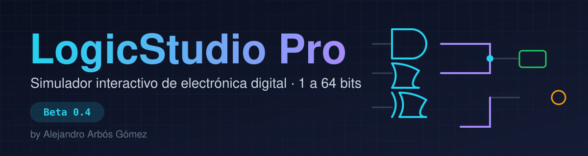
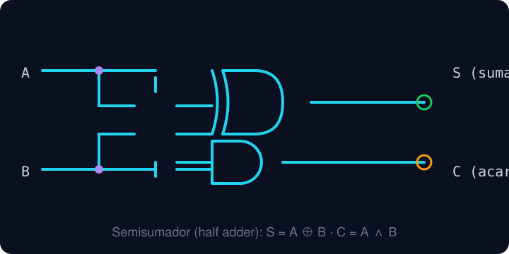

<div align="center">



# LogicStudio Pro

**Simulador interactivo de electrónica digital y arquitectura de computadores de 1 a 64 bits.**

[](#-changelog)
[](LICENSE)
[](https://logicstudio-pro.ai.studio/)
[](https://react.dev/)
[](https://www.typescriptlang.org/)

🚀 **[Probar la app en el navegador → logicstudio-pro.ai.studio](https://logicstudio-pro.ai.studio/)**

</div>

---

## ✨ ¿Qué es?

LogicStudio Pro es un entorno de diseño de circuitos digitales que corre en el navegador. Puedes construir desde una simple puerta NOT hasta una ALU de 64 bits, verla funcionar en tiempo real, y exportar tu trabajo.

Está pensado tanto para **aprender** (incluye lecciones guiadas y retos) como para **experimentar** con sistemas completos (memorias ROM, buses multi-bit, contadores, displays hexadecimales).

<div align="center">

<br/>
<sub>Ejemplo: un semisumador construido con una XOR y una AND.</sub>
</div>

## 🧩 Características

- **Simulación en tiempo real** con reloj global ajustable (0.5–15 Hz), modo paso a paso y multiplicador de ciclos (incluido modo *turbo*).
- **Lienzo interactivo** con soporte para ratón y trackpad.
- **Catálogo de componentes**: puertas lógicas, flip-flops, multiplexores, sumadores, memorias ROM/RAM, contadores y displays.
- **Buses multi-bit de 1 a 64 bits.**
- **Lecciones guiadas** (10 módulos, desde bits e interruptores hasta una ALU) y **retos** para comprobar lo aprendido.
- **Programador de memorias** para cargar contenido en ROM/RAM, con soporte para líneas `mem=` comprimidas.
- **Síntesis booleana**: escribe una expresión (`A AND (B OR NOT C)`) y obtén el circuito.
- **LogicScript**: lenguaje propio para describir circuitos en texto, con compilador y diagnósticos.
- **Exportación a Logisim-Evolution** (`.circ`) para seguir el trabajo en otra herramienta.
- **Sonido**: los circuitos pueden generar tonos.
- **Presets de ejemplo**, incluida una demo de bienvenida con LED RGB.

## 🛠️ Stack

| Área | Tecnología |
|---|---|
| UI | React 19 + TypeScript |
| Build | Vite 8 |
| Estilos | Tailwind CSS 4 |
| Iconos | lucide-react |
| Animaciones | motion |
| Tests | Suite de pruebas del motor (`src/engine/engine.test.ts`) |

## 🚀 Puesta en marcha local

**Requisitos:** Node.js 20 o superior y npm.

```bash
# 1. Clona el repositorio
git clone https://github.com/<tu-usuario>/LogicStudio-Pro.git
cd LogicStudio-Pro

# 2. Instala dependencias
npm install

# 3. Arranca el servidor de desarrollo (http://localhost:3000)
npm run dev
```

Otros comandos útiles:

```bash
npm run build     # genera la versión de producción en dist/
npm run preview   # sirve la build localmente
npm run lint      # comprobación de tipos con TypeScript
```

> **Nota:** el archivo `.env.example` contiene variables de entorno opcionales. Copia el archivo a `.env.local` solo si necesitas configurarlas. Nunca subas tu `.env` real al repositorio.

## 📁 Estructura del proyecto

```
src/
├── engine/        # Núcleo: simulador, catálogo, lecciones, retos, LogicScript, exportación
├── ui/            # Controlador, renderizado de canvas, sonido, programador de memorias
├── presets/       # Circuitos de ejemplo
├── App.tsx        # Interfaz principal
└── main.tsx       # Punto de entrada
```

## 📝 Changelog

### Beta 0.4 *(versión actual)*
- Primera versión beta publicada en línea.


## 🤝 Contribuir

¡Las ideas, reportes de errores y pull requests son bienvenidos!

1. Haz un *fork* del repositorio.
2. Crea una rama para tu cambio (`git checkout -b feature/mi-mejora`).
3. Haz commit de tus cambios y abre un *pull request*.

## 📜 Licencia y atribución

Este proyecto está licenciado bajo **[Creative Commons Atribución-NoComercial-CompartirIgual 4.0 Internacional (CC BY-NC-SA 4.0)](https://creativecommons.org/licenses/by-nc-sa/4.0/deed.es)**. Consulta el archivo [LICENSE](LICENSE).

En resumen:

- ✅ **Puedes** usar, estudiar, modificar y redistribuir el proyecto.
- ✅ **Debes** dar crédito al autor original (Alejandro Arbós Gómez) e indicar la licencia.
- ✅ **Si haces un fork o una versión derivada**, debes **enlazar este repositorio** como fuente original y mantener la misma licencia.
- ❌ **No puedes** vender el proyecto ni usarlo con fines comerciales (monetizar la app, cobrar por el acceso, incluir anuncios con ánimo de lucro, etc.).

**Cita sugerida:**

> LogicStudio Pro (Beta 0.4), por Alejandro Arbós Gómez. Licencia CC BY-NC-SA 4.0. Repositorio original: https://github.com/<tu-usuario>/LogicStudio-Pro

## 👤 Autor

**Alejandro Arbós Gómez**

🔗 Demo: [logicstudio-pro.ai.studio](https://logicstudio-pro.ai.studio/)

---

<div align="center">
<sub>Si te resulta útil, ⭐ deja una estrella en el repositorio.</sub>
</div>
